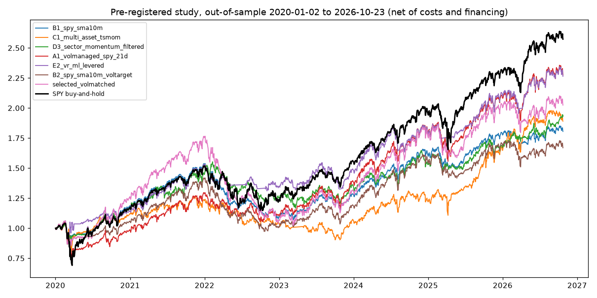

# Algorithmic Trading Strategy: Volatility Regime Backtester

A Python backtester for a single-asset volatility-regime strategy, with
next-open execution, transaction costs, walk-forward machine learning, Brinson
attribution and an in-sample / out-of-sample (IS/OOS) study against SPY
buy-and-hold.

## Study 1: volatility-regime grid (honest summary)

The study (`python scripts/run_oos_study.py`) uses SPY daily bars (Yahoo
Finance, split- and dividend-adjusted) and a protocol that was fixed before
looking at the out-of-sample data:

* **In-sample (selection):** 2010-01-01 to 2019-12-31. The candidate with the
  highest Sharpe ratio (daily returns in excess of 3-month T-bills) is chosen.
* **Out-of-sample (evaluated once):** 2020-01-02 to 2026-10-23.
* **Execution:** decisions on the close, fills at the next open, 2 bp per side,
  idle cash earns T-bills, leverage is financed at T-bills + 1%.
* **Candidates:** the volatility-regime strategy over `vol_threshold`
  {0.6, 0.7, 0.8} x `max_hold_days` {5, 10} x ML gate {off, on}; a monthly
  SMA trend filter (150 and 200 days); volatility-managed SPY (target 12% and
  16%, leverage cap 1.5x).

In-sample, **no candidate beat SPY buy-and-hold on Sharpe** (SPY 0.88; best
candidate 0.86). The rule picked `volmanaged_target16`.

Out-of-sample, net of costs (average T-bill rate over the period: 2.8%):

| Strategy | CAGR | Total return | Sharpe | Volatility | Max drawdown |
|---|---:|---:|---:|---:|---:|
| Selected: vol-managed SPY, 16% target | 13.62% | 138.1% | 0.64 | 18.1% | -29.2% |
| Volatility regime, default parameters (ML off) | 15.10% | 159.9% | 0.76 | 16.4% | -24.3% |
| Volatility regime, default parameters (ML on) | 14.92% | 157.3% | 0.83 | 14.6% | -20.7% |
| **SPY buy-and-hold** | **15.12%** | **160.2%** | 0.66 | 20.0% | -33.7% |

What this does and does not show:

* **None of the strategies beat buy-and-hold on raw return.** The selected
  strategy lagged SPY by about 1.5 percentage points a year, and its Sharpe
  ratio was also slightly lower.
* The volatility-regime strategy with its default parameters roughly matched
  SPY's return with lower volatility and a smaller drawdown, so its OOS Sharpe
  was higher (0.76-0.83 vs 0.66). It was **not** the in-sample pick: over
  2010-2019 it returned 5.3%/yr (Sharpe 0.42) against 13.3%/yr for SPY. One
  favourable OOS period after a poor IS period is weak evidence. Treat it as a
  risk-reduction result, not proof of an edge.
* All of this is one asset and one historical path. Nothing here is investment
  advice.


Full in-sample and out-of-sample statistics are in `results/oos_study.json`.

## Study 2: pre-registered search for a strategy that beats SPY

The candidates, costs, selection rule and OOS shortlist were committed in
[`results/candidates.md`](results/candidates.md) (commit `2288ba9`). The
in-sample selection was committed next (`c287f01`, data cut at 2019-12-31).
Only after that was the OOS period run, once.

```bash
python scripts/run_preregistered_study.py --phase is
python scripts/run_preregistered_study.py --phase oos
```

**Setup**
* Universe: liquid ETFs that all existed before 2007 (SPY, QQQ, IWM, EFA,
  EEM, TLT, IEF, GLD, DBC, and the nine SPDR sectors).
* Execution: next-open fills. Costs are 2-5 bp per side. Borrowed cash pays
  T-bill + 50 bp, and idle cash earns T-bills.
* In-sample (IS): 2007-01-03 to 2019-12-31. Out-of-sample (OOS): 2020-01-02 to
  2026-10-23.

**In-sample (all 14 candidates, in `results/study2_is_selection.json`)**
* SPY buy-and-hold: CAGR 8.69%, Sharpe 0.48, max drawdown -55.2%.
* The highest IS Sharpe was **B1**: hold SPY above its 10-month SMA, IEF below
  it (CAGR 10.36%, Sharpe 0.76, max drawdown -21.1%). B1 was selected.
* Its vol-matched version (k = 1.49, fixed from IS) had IS CAGR 14.05% vs
  SPY's 8.69%.
* The Deflated Sharpe Ratio of B1 with 14 trials was 0.97. The Sharpe expected
  from the best of 14 skill-less trials is 0.24.
* The walk-forward re-selection inside IS (2010-2019) earned 7.8%/yr against
  SPY's 13.5%. It beat SPY in only 3 of 10 years, an early warning that the
  selection was fragile.

**Out-of-sample, evaluated once (net of costs and financing)**

| Strategy | CAGR | Sharpe | Vol | Max DD | Gross leverage avg / max | Costs/yr | Beats SPY CAGR? |
|---|---:|---:|---:|---:|---:|---:|:---:|
| **B1 SMA filter (selected)** | 9.15% | 0.50 | 13.7% | -30.4% | 1.00 / 1.00 | 0.09% | No |
| B1 vol-matched to SPY's IS vol (ex ante, k = 1.49) | 11.03% | 0.49 | 19.5% | -42.0% | 1.42 / 1.57 | 0.13% | No |
| B2 SMA filter, 15% vol target | 7.93% | 0.38 | 15.7% | -31.4% | 1.18 / 1.58 | 0.12% | No |
| C1 multi-asset trend, 15% vol target | 9.89% | 0.48 | 16.6% | -28.8% | 1.37 / 2.18 | 0.17% | No |
| D3 sector momentum + SPY filter | 10.39% | 0.55 | 14.6% | -24.9% | 1.00 / 1.00 | 0.22% | No |
| A1 vol-managed SPY (21-day) | 12.96% | 0.63 | 17.3% | -27.6% | 1.06 / 1.56 | 0.07% | No |
| E2 repo strategy + ML, vol-scaled | 12.88% | 0.71 | 14.5% | -14.4% | 0.90 / 1.54 | 0.12% | No |
| **SPY buy-and-hold** | **14.99%** | 0.66 | 20.0% | -33.7% | 1.00 / 1.00 | 0.00% | - |

Ex-post leverage-matched comparison (hypothetical: excess returns scaled so
OOS volatility equals SPY's, extra borrowing at T-bill + 50 bp):

| Strategy | k | CAGR | Sharpe | Max DD |
|---|---:|---:|---:|---:|
| B1 | 1.46 | 11.19% | 0.49 | -42.6% |
| C1 | 1.20 | 10.61% | 0.46 | -34.9% |
| D3 | 1.37 | 12.45% | 0.55 | -33.6% |
| A1 | 1.16 | 14.13% | 0.62 | -31.3% |
| E2 | 1.37 | 15.98% | 0.70 | -20.3% |

**Conclusion.** No pre-registered strategy beat SPY buy-and-hold on raw
return out of sample, including the selected one and its leveraged version.

* A likely explanation, not tested here: the 2007-2019 in-sample period
  contains 2008, when trend filters shine. The 2020-2026 period was dominated
  by fast V-shaped recoveries (2020, 2025), when they sell low and buy back
  higher.
* The only number above SPY's return is E2 leverage-matched after the fact
  (15.98%). That uses OOS volatility to choose the leverage, and E2 had the
  worst IS Sharpe of the 14 candidates. It is not a tradeable result and was
  not selected.
* What the data does support: several strategies had smaller drawdowns than
  SPY, and E2 and A1 had similar or higher Sharpe ratios. None converted that
  into a higher return after costs.

Small data note: the OOS phase recomputes the IS statistics from the full
download. They match exactly for 13 of 14 candidates. E2 differs by 0.5%/yr of
IS CAGR because Yahoo's dividend adjustment differs at the 1e-6 level between
the two download windows, which flips some RandomForest splits. This does not
affect the selection.



## Study 3: walk-forward machine learning (pre-registered, failed)

Protocol: [`results/study3_protocol.md`](results/study3_protocol.md) (commit
`7a5b06c`). Frozen config: [`results/frozen_config.md`](results/frozen_config.md)
(commit `d1fd68b`). The holdout was run once after the freeze.

```bash
python scripts/run_ml_study.py --phase dev       # SPY, data cut at 2023-12-31
python scripts/run_ml_study.py --phase holdout   # frozen config, run once
```

**Method**
* **Recursive learning.** Expanding-window walk-forward with monthly refits.
  Hyper-parameters are re-chosen once a year by purged, embargoed 5-fold CV
  inside each training window.
* **Models.** Ridge, LightGBM, an MLP and their ensemble, predicting the next
  21-day excess return.
* **Features.** 24 point-in-time features: multi-horizon momentum,
  volatility, drawdown, VIX, T-bill, FRED term and credit spreads, jobless
  claims (with publication lags), and sector breadth.
* **Sizing.** Three rules (mean-variance, vol-target tilt, vol-target gate)
  with a 1.5x cap, plus a no-ML vol-target reference. That makes 13 configs,
  all in [`results/trials_log.csv`](results/trials_log.csv).
* **Execution.** Next-open fills, 2-5 bp costs, financing at T-bill + 50 bp.

**Hardware.** The models are small and the data is about 6,000 daily rows, so
all training ran on CPU. On an AMD RX 9070 (PyTorch DirectML, Windows), the
GPU was slower than CPU for the small networks used here. It was faster only
for networks of 1,024 units and wider. LSTM layers are not supported by
DirectML, and the LightGBM Windows wheel has no GPU build.

**Development (SPY 2000-2023; 2020-2023 had already been seen in studies 1 and 2)**
* Every ML config earned less than the no-ML vol-target reference. That
  reference was selected by the registered rule (highest development CAGR):
  8.44% vs SPY's 6.92%, Sharpe 0.45 vs 0.35, max drawdown -44.5% vs -55.2%.
* Its deflated Sharpe ratio (active return, N = 45 trials across all three
  studies) is 0.29, far below the 0.95 bar.

**Holdouts (run once, net of costs)**

| Holdout | Period | CAGR | B&H CAGR | Sharpe | B&H Sharpe | Max DD | B&H Max DD | Beats B&H? |
|---|---|---:|---:|---:|---:|---:|---:|:---:|
| SPY 2024+ | 2024-01-02 to 2026-10-23 | 19.75% | 19.89% | 0.83 | 0.98 | -23.4% | -18.8% | No |
| EFA | 2007-01-03 to 2026-10-23 | 3.69% | 4.71% | 0.21 | 0.25 | -46.5% | -61.0% | No |
| EWJ | 2001-08-01 to 2026-10-23 | 4.27% | 5.11% | 0.22 | 0.26 | -55.5% | -54.5% | No |
| EWG | 2001-08-01 to 2026-10-23 | 3.57% | 5.90% | 0.20 | 0.29 | -65.9% | -63.1% | No |
| EWU | 2001-08-01 to 2026-10-23 | 4.98% | 5.48% | 0.25 | 0.27 | -56.6% | -64.0% | No |
| EWC | 2001-08-01 to 2026-10-23 | 8.22% | 8.84% | 0.38 | 0.42 | -57.5% | -60.8% | No |
| S&P 500 TR, pre-2000 | 1996-01-02 to 1999-12-31 | 20.36% | 26.06% | 1.02 | 1.14 | -17.0% | -19.2% | No |

**Verdict: FAIL.** Criteria 1 (development CAGR) and 5 (rolling 3-year win
rate 73%) passed. Criteria 2 (SPY 2024+), 3 (0 of 6 cross-market holdouts) and
4 (deflated Sharpe) failed.

* The development edge was specific to SPY 2000-2023 and did not carry over to
  new data or other markets.
* Machine learning on these features added no value over simple volatility
  targeting.
* The results are in `results/study3_dev.json` and
  `results/study3_holdout.json`.

## Study 4: long-only large-cap factor tilts (pre-registered, failed)

Studies 1-3 tried to time the market. Study 4 tests a different source of
return: holding large caps with a documented factor premium, fully invested
and unlevered.

Protocol: [`results/study4_protocol.md`](results/study4_protocol.md) (commit
`f761f04`). Frozen config:
[`results/study4_frozen_config.md`](results/study4_frozen_config.md) (commit
`32aa988`). The holdout was run once after the freeze.

```bash
python scripts/run_factor_study.py --phase dev
python scripts/run_factor_study.py --phase holdout
```

**Data and its limits**
* Free survivorship-free stock-level data does not exist, because Yahoo drops
  delisted tickers. The study therefore uses the Kenneth R. French Data
  Library, built from CRSP and Bloomberg, which includes delisted stocks and
  forms portfolios point in time.
* Returns are gross. A pre-registered drag from assumed turnover (10 bp per
  side plus a 0.15%/yr fee) is deducted.
* Rebalancing is assumed at month-end closes. "Large cap" means above the
  NYSE median size.

**Candidates.** Five candidates (N = 50 trials counting studies 1-3):
* F1: large-cap momentum
* F2: large-cap value
* F3: large-cap profitability
* F4: low-variance quintile
* F5: an equal mix of F1-F3

The rule was "highest development CAGR (US 1963-1999) net of costs". It
picked **F1, large-cap momentum** (16.13% vs the market's 12.63%).

**Holdout H1, US 2000-01 to 2026-08, vs SPY (net of costs)**

| | CAGR | Sharpe | Max DD | Vol |
|---|---:|---:|---:|---:|
| **F1 large-cap momentum (selected)** | 8.33% | 0.46 | -48.4% | 16.1% |
| SPY | 8.28% | 0.48 | -50.8% | 15.2% |

* With 2x costs, F1 earns 7.74%.
* By subperiod (F1 vs SPY): 2000-08 -1.7% vs -3.7%; 2009-17 14.0% vs 15.1%;
  2018-26 13.7% vs 14.7%.
* Other markets:
  * US 1927-1963: F1 13.19% vs the market's 9.37%.
  * Developed ex-US 1990-2026: F1 8.02% vs 6.38%. F1's ex-US series starts
    in 1990-11, the market's in 1990-07.

**Criteria**

| # | Criterion | Result |
|---|---|---|
| 1 | H1 CAGR beats SPY | Pass, barely (+0.05 pp) |
| 2 | Beats SPY with 2x costs | Fail |
| 3 | Beats SPY in 2 of 3 subperiods | Fail (1/3) |
| 4a | Deflated Sharpe >= 0.95 | Fail (0.07) |
| 4b | H1 active PSR >= 0.95 | Fail (0.55) |
| 5 | Beats its market in 1927-63 and ex-US | Pass |

**Verdict: FAIL.** Large-cap momentum beat the market before 1963 and outside
the US, but in the US since 2000 it only tied SPY after costs.

* F3 (profitability), F4 (low variance) and F5 (the mix) each beat SPY in H1
  (10.05%, 9.53% and 9.65% vs 8.28%; Sharpe 0.60, 0.67 and 0.55 vs 0.48).
  The development rule did not select them, so this is not evidence for any of
  them. Choosing one now would be selection on the holdout.
* All holdout numbers for every candidate are in `results/study4_holdout.json`.

**Small-fund feasibility**
* The portfolios hold value-weighted large caps, so capacity is in the
  billions. A $1-50M fund would trade a negligible share of volume.
* The binding constraints are turnover (assumed 200%/yr for momentum, 30% for
  value and profitability) and fees. Listed ETFs (MTUM, VLUE, QUAL, USMV)
  implement similar but not identical rules for 0.15-0.25%/yr.

### Live paper test of the frozen study 3 rule

The study 3 rule (`none_voltarget`) is frozen at tag `paper-trade-v1`
(commit `cfd8a9f`).

* **Rule.** SPY weight = long-run vol / 63-day vol, clipped to 0-1.5x.
  Decided at the Friday close, filled at the next open.
* **Start.** The live test begins with the fill at the 2026-10-26 open, after
  the decision at the 2026-10-23 close.
* **Update.** `python scripts/paper_trade_update.py` rewrites
  `results/paper_trade_live.csv` and `results/paper_trade_summary.json` from
  that date onward.
* **How it is judged.** After 12 and 24 months: it passes only if its CAGR,
  net of 2 bp costs and T-bill + 50 bp financing, is above SPY buy-and-hold
  over the same live window. Nothing about the rule changes in the meantime.

## How the strategy works

1. **Volatility regime.** 20-day realised volatility, ranked over the last 252
   sessions. "High vol" means the rank is above `vol_threshold` (0.70).
2. **Trend sleeve.** Long while the close is above the 50-day average and the
   Black-Scholes cone from realised volatility puts the odds of finishing above
   the 20-day EMA at 50% or more. It exits when price is more than 3% below the
   50-day average and those odds fall below 45%. No shorts while price is above
   the 50-day average.
3. **High-vol fades and breakouts.** Only in the high-vol regime: fade a move
   outside the expected-move cone back toward the 20-day EMA, or follow a
   breakout. These trades use an ATR stop and target and a time stop of
   `max_hold_days` bars.
4. **Optional ML gate (`--train-ml`).** A walk-forward RandomForest refits every
   21 bars on labels that are already known and gates fades at P(up) 0.55 / 0.45.
5. **Execution.** Signals use information up to the close of bar t. Orders fill
   at the open of bar t+1, with `cost_bps` per side (default 2 bp).
6. **Attribution.** Brinson allocation, selection and interaction versus
   buy-and-hold.

## Installation

Requires Python 3.10+.

```bash
git clone https://github.com/diaabraham/algorithmic-trading-strategy.git
cd algorithmic-trading-strategy
python -m venv venv
source venv/bin/activate  # On Windows: venv\Scripts\activate
pip install -r requirements.txt
```

## Usage

Run a single backtest:

```bash
python main.py --symbol SPY --start-date 2020-01-01 --end-date 2023-12-31
python main.py --symbol SPY --start-date 2020-01-01 --end-date 2023-12-31 --train-ml --plot
```

Reproduce the IS/OOS study:

```bash
python scripts/run_oos_study.py              # through today
python scripts/run_oos_study.py --end-date 2026-10-23 --cost-bps 2
```

Main options:

- `--symbol`, `--start-date`, `--end-date`, `--initial-capital`
- `--holding-days`: time stop for fade and breakout trades (default 5)
- `--cost-bps`: cost per side in basis points (default 2)
- `--train-ml`, `--ml-long-min`, `--ml-short-max`: walk-forward ML gate (off by default)
- `--sentiment`, `--use-twitter`, `--alpha-vantage-key`: optional news and Twitter sentiment filter
- `--plot`: save equity, drawdown, trade and regime charts to `plots/`
- `--rigorous-test --symbols SPY,QQQ,IWM --as-of YYYY-MM-DD`: six-month and one-week validation suite (`--as-of` defaults to today)
- `--portfolio-mc`: equal-weight bootstrap Monte Carlo over `--mc-symbols` (default SPY,QQQ,IWM,TLT,GLD), from `--mc-window-start` (default one year before `--as-of`)
- `--live`, `--order-qty`: route the latest signal to Interactive Brokers (guarded; see below)

## Data and configuration

Daily OHLCV is fetched from Massive, Databento or Polygon when their API keys
are set, otherwise from Yahoo Finance and then Stooq. `WTI` maps to the `USO`
ETF. Options and futures chains are not modelled.

Copy `.env.example` to `.env` to set optional keys (`MASSIVE_API_KEY`,
`DATABENTO_API_KEY`, `POLYGON_API_KEY`, `ALPHAVANTAGE_API_KEY`), the IBKR
connection, and the risk caps.

Live routing is off unless `LIVE_TRADING_ENABLED=true`. Paper mode refuses IBKR
live ports, contracts are qualified before an order is placed, and orders are
blocked if the backtest has Sharpe <= 0, CAGR <= 0 or a win rate below 45%.

## Project structure

```
algorithmic-trading-strategy/
├── main.py                 # Command-line backtest, rigorous suite, Monte Carlo, live routing
├── scripts/
│   ├── run_oos_study.py    # Study 1
│   ├── run_preregistered_study.py  # Study 2 (pre-registered)
│   ├── run_ml_study.py     # Study 3 (walk-forward ML)
│   ├── paper_trade_update.py  # Live paper test of the frozen study 3 rule
│   ├── run_factor_study.py # Study 4 (factor tilts, Ken French data)
│   └── verify_real_market.py
├── src/
│   ├── strategy.py         # Volatility regime strategy
│   ├── execution.py        # Next-open fill simulator with costs and financing
│   ├── oos_study.py        # Study 1: candidates, selection rule and evaluation
│   ├── portfolio_backtest.py # Multi-asset next-open simulator, stats, deflated Sharpe
│   ├── candidates.py       # Study 2 pre-registered candidates
│   ├── ml_research/        # Study 3 walk-forward ML pipeline
│   ├── factor_study.py     # Study 4 data, costs and statistics
│   ├── data_loader.py      # Data providers and features
│   ├── ml_signal.py        # Walk-forward RandomForest
│   ├── black_scholes.py    # Realised-vol cone and N(d2)
│   ├── brinson.py          # Brinson attribution versus buy-and-hold
│   ├── model_runner.py     # Rigorous suite and parameter grid
│   ├── portfolio_sim.py    # Equal-weight Monte Carlo
│   ├── broker_ibkr.py      # Guarded IBKR routing
│   ├── live_trading.py
│   └── visualization.py
├── results/                # candidates.md, study outputs (JSON and charts)
├── notebooks/              # Early research notebooks
└── tests/
```

## Tests

```bash
pytest -q
```

`tests/test_market_integration.py` downloads live daily bars and is marked
`integration`. Skip it offline with `pytest -m "not integration"`.

## Limitations

- Single asset, daily bars, one historical path.
- Costs are a flat 2 bp per side. That is reasonable for SPY at small size, but
  not for illiquid names.
- The Monte Carlo resamples trade returns independently per symbol and has no
  correlation model.

## License

MIT. See [LICENSE](LICENSE).
