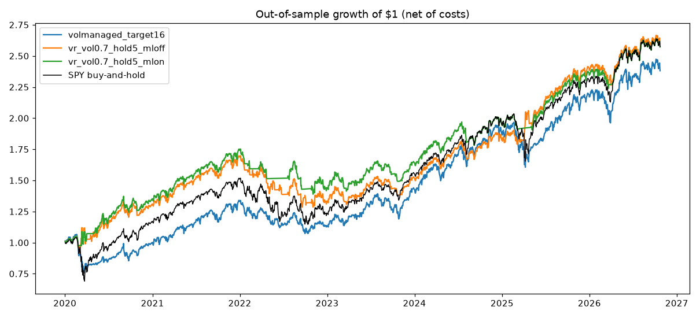

# Algorithmic Trading Strategy: Volatility Regime Backtester

A Python backtester for a single-asset volatility-regime strategy, with
next-open execution, transaction costs, walk-forward machine learning, Brinson
attribution and an in-sample / out-of-sample (IS/OOS) study against SPY
buy-and-hold.

## Results (honest summary)

The study (`python scripts/run_oos_study.py`) uses SPY daily bars (Yahoo
Finance, split- and dividend-adjusted) and a protocol that was fixed before
looking at the out-of-sample data:

* **In-sample (selection):** 2010-01-01 to 2019-12-31. The candidate with the
  highest Sharpe ratio (daily returns in excess of 3-month T-bills) is chosen.
* **Out-of-sample (evaluated once):** 2020-01-02 to 2026-10-23.
* **Execution:** decisions on the close, fills at the next open, 2 bp per side,
  idle cash earns T-bills, leverage is financed at T-bills + 1%.
* **Candidates:** the volatility-regime strategy over `vol_threshold`
  {0.6, 0.7, 0.8} x `max_hold_days` {5, 10} x ML gate {off, on}; a monthly
  SMA trend filter (150 and 200 days); volatility-managed SPY (target 12% and
  16%, leverage cap 1.5x).

In-sample, **no candidate beat SPY buy-and-hold on Sharpe** (SPY 0.88; best
candidate 0.86). The rule picked `volmanaged_target16`.

Out-of-sample, net of costs (average T-bill rate over the period: 2.8%):

| Strategy | CAGR | Total return | Sharpe | Volatility | Max drawdown |
|---|---:|---:|---:|---:|---:|
| Selected: vol-managed SPY, 16% target | 13.62% | 138.1% | 0.64 | 18.1% | -29.2% |
| Volatility regime, default parameters (ML off) | 15.10% | 159.9% | 0.76 | 16.4% | -24.3% |
| Volatility regime, default parameters (ML on) | 14.92% | 157.3% | 0.83 | 14.6% | -20.7% |
| **SPY buy-and-hold** | **15.12%** | **160.2%** | 0.66 | 20.0% | -33.7% |

What this does and does not show:

* **None of the strategies beat buy-and-hold on raw return.** The selected
  strategy lagged SPY by about 1.5 percentage points a year, and its Sharpe
  ratio was also slightly lower.
* The volatility-regime strategy with its default parameters roughly matched
  SPY's return with lower volatility and a smaller drawdown, so its OOS Sharpe
  was higher (0.76-0.83 vs 0.66). It was **not** the in-sample pick: over
  2010-2019 it returned 5.3%/yr (Sharpe 0.42) against 13.3%/yr for SPY. One
  favourable OOS period after a poor IS period is weak evidence. Treat it as a
  risk-reduction result, not proof of an edge.
* All of this is one asset and one historical path. Nothing here is investment
  advice.



Full in-sample and out-of-sample statistics are in `results/oos_study.json`.

## How the strategy works

1. **Volatility regime.** 20-day realised volatility, ranked over the last 252
   sessions. "High vol" means the rank is above `vol_threshold` (0.70).
2. **Trend sleeve.** Long while the close is above the 50-day average and the
   Black-Scholes cone from realised volatility puts the odds of finishing above
   the 20-day EMA at 50% or more. It exits when price is more than 3% below the
   50-day average and those odds fall below 45%. No shorts while price is above
   the 50-day average.
3. **High-vol fades and breakouts.** Only in the high-vol regime: fade a move
   outside the expected-move cone back toward the 20-day EMA, or follow a
   breakout. These trades use an ATR stop and target and a time stop of
   `max_hold_days` bars.
4. **Optional ML gate (`--train-ml`).** A walk-forward RandomForest refits every
   21 bars on labels that are already known and gates fades at P(up) 0.55 / 0.45.
5. **Execution.** Signals use information up to the close of bar t. Orders fill
   at the open of bar t+1, with `cost_bps` per side (default 2 bp).
6. **Attribution.** Brinson allocation, selection and interaction versus
   buy-and-hold.

## Installation

Requires Python 3.10+.

```bash
git clone https://github.com/diaabraham/algorithmic-trading-strategy.git
cd algorithmic-trading-strategy
python -m venv venv
source venv/bin/activate  # On Windows: venv\Scripts\activate
pip install -r requirements.txt
```

## Usage

Run a single backtest:

```bash
python main.py --symbol SPY --start-date 2020-01-01 --end-date 2023-12-31
python main.py --symbol SPY --start-date 2020-01-01 --end-date 2023-12-31 --train-ml --plot
```

Reproduce the IS/OOS study:

```bash
python scripts/run_oos_study.py              # through today
python scripts/run_oos_study.py --end-date 2026-10-23 --cost-bps 2
```

Main options:

- `--symbol`, `--start-date`, `--end-date`, `--initial-capital`
- `--holding-days`: time stop for fade and breakout trades (default 5)
- `--cost-bps`: cost per side in basis points (default 2)
- `--train-ml`, `--ml-long-min`, `--ml-short-max`: walk-forward ML gate (off by default)
- `--sentiment`, `--use-twitter`, `--alpha-vantage-key`: optional news and Twitter sentiment filter
- `--plot`: save equity, drawdown, trade and regime charts to `plots/`
- `--rigorous-test --symbols SPY,QQQ,IWM --as-of YYYY-MM-DD`: six-month and one-week validation suite (`--as-of` defaults to today)
- `--portfolio-mc`: equal-weight bootstrap Monte Carlo over `--mc-symbols` (default SPY,QQQ,IWM,TLT,GLD), from `--mc-window-start` (default one year before `--as-of`)
- `--live`, `--order-qty`: route the latest signal to Interactive Brokers (guarded; see below)

## Data and configuration

Daily OHLCV is fetched from Massive, Databento or Polygon when their API keys
are set, otherwise from Yahoo Finance and then Stooq. `WTI` maps to the `USO`
ETF. Options and futures chains are not modelled.

Copy `.env.example` to `.env` to set optional keys (`MASSIVE_API_KEY`,
`DATABENTO_API_KEY`, `POLYGON_API_KEY`, `ALPHAVANTAGE_API_KEY`), the IBKR
connection, and the risk caps.

Live routing is off unless `LIVE_TRADING_ENABLED=true`. Paper mode refuses IBKR
live ports, contracts are qualified before an order is placed, and orders are
blocked if the backtest has Sharpe <= 0, CAGR <= 0 or a win rate below 45%.

## Project structure

```
algorithmic-trading-strategy/
├── main.py                 # Command-line backtest, rigorous suite, Monte Carlo, live routing
├── scripts/
│   ├── run_oos_study.py    # IS/OOS study against SPY buy-and-hold
│   └── verify_real_market.py
├── src/
│   ├── strategy.py         # Volatility regime strategy
│   ├── execution.py        # Next-open fill simulator with costs and financing
│   ├── oos_study.py        # Candidates, selection rule and evaluation
│   ├── data_loader.py      # Data providers and features
│   ├── ml_signal.py        # Walk-forward RandomForest
│   ├── black_scholes.py    # Realised-vol cone and N(d2)
│   ├── brinson.py          # Brinson attribution versus buy-and-hold
│   ├── model_runner.py     # Rigorous suite and parameter grid
│   ├── portfolio_sim.py    # Equal-weight Monte Carlo
│   ├── broker_ibkr.py      # Guarded IBKR routing
│   ├── live_trading.py
│   └── visualization.py
├── results/                # Study output (JSON and chart)
├── notebooks/              # Early research notebooks
└── tests/
```

## Tests

```bash
pytest -q
```

`tests/test_market_integration.py` downloads live daily bars and is marked
`integration`. Skip it offline with `pytest -m "not integration"`.

## Limitations

- Single asset, daily bars, one historical path.
- Costs are a flat 2 bp per side. That is reasonable for SPY at small size, but
  not for illiquid names.
- The Monte Carlo resamples trade returns independently per symbol and has no
  correlation model.

## License

MIT. See [LICENSE](LICENSE).
